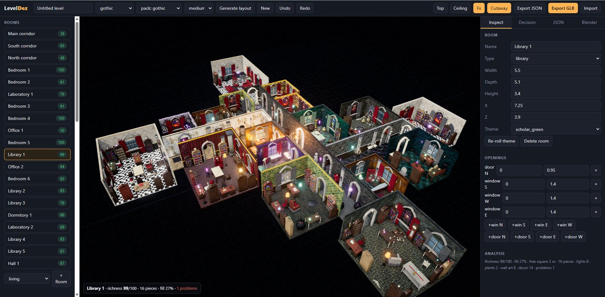
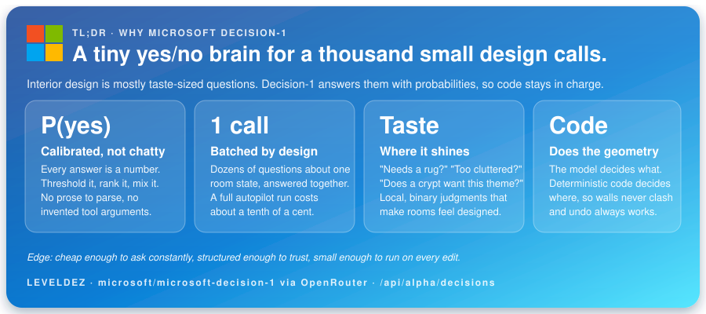
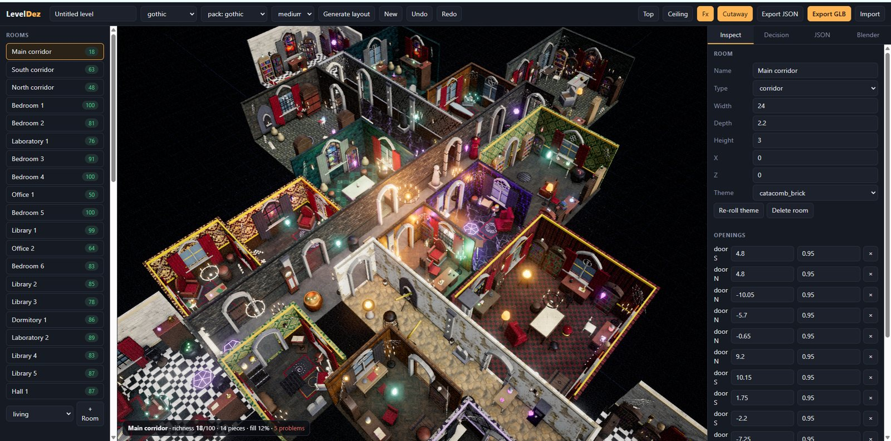
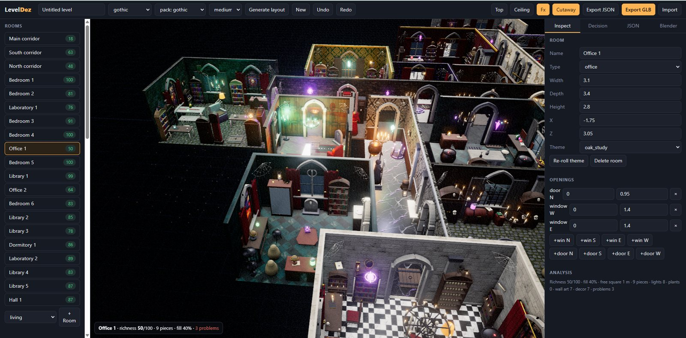
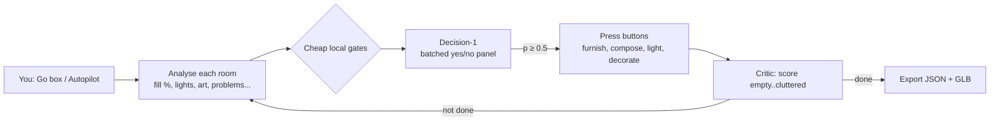

<div align="center">

# LevelDez

### A 3D interior level designer that furnishes itself.

Design richly furnished indoor spaces in your browser, **hand the boring parts to a yes/no AI**, and export a **JSON** layout plus a **multi-mesh GLB** your engine can load.






</div>

---

## Demonstration video: Fill any layout with any set of assets (at runtime, almost instantly)

<div align="center">
GOTHIC
<video src="[docs/demo.mp4](https://github.com/user-attachments/assets/bb26f89f-c223-4fe9-8b82-cc8257e73eba)" controls muted loop playsinline width="100%">
  Your viewer can't play embedded video. <a href="docs/demo.mp4">Watch the demo (mp4)</a>.
</video>
SCIFI
<video src="[docs/demo-scifi.mp4](https://github.com/user-attachments/assets/1bead312-8d45-42cc-b9a5-4df93e673f0a
)" controls muted loop playsinline width="100%">
  Your viewer can't play embedded video. <a href="docs/demo-scifi.mp4">Watch the sci-fi demo (mp4)</a>.
</video>
</div>

---

## Why this exists

Greyboxing a believable interior is slow: a floor plan, forty doors, a hundred props, lighting, and the hundred small decisions that make a room feel *lived in*. LevelDez automates those decisions with a small, cheap model and a library of real assets, and keeps **you** in control with an ordinary editor and undo.

- 🏰 **One sentence → a whole building.** Corridors, side wings, big halls and rooms of every size, furnished, lit and decorated.
- 🧠 **A yes/no model as the "hands".** Microsoft **Decision-1** answers calibrated probabilities. LevelDez turns them into button presses (a full autopilot run costs roughly a tenth of a cent).
- 🎨 **Every room has an identity.** Per-room wallpaper or stone, floor, wainscot, trim and a coloured mood light, chosen to suit what the room *is*.
- 🪑 **Rooms are composed, not sprinkled.** Reading nooks, altars with candelabras, lab benches with cauldrons, crypt rows, classroom rows, ritual circles.
- 📦 **~600 hand-built assets** (a complete gothic *necromancer academy* pack), built in Blender, loaded lazily so the editor stays fast.
- 🎬 **Cinematic viewport.** Ambient occlusion, bloom, colour grading, dust, flickering candlelight and soft shadows.
- 🧰 **Zero npm dependencies.** One small Node server and static files.

<div align="center">


</div>

---

## Quick start

The quickest is that you vibe your own stuff (took me a few hours), but I'm sharing my project so that my claims are not empty-handed and it can be tried out.

```bash
git clone https://github.com/yeme-oss/LevelDez.git
cd LevelDez
cp .env.example .env        # optional: add your keys (see below)
npm start                   # -> http://localhost:5173
```

Requires **Node 18+**. No `npm install` is needed. three.js is loaded from a CDN, so the first load needs an internet connection.

Then, in the browser:

1. Click **Generate layout** (choose *small / medium / large*) in the header.
2. Open the **Decision** tab, tick **all rooms** and press **Autopilot**.
3. Orbit with the mouse, click props to move them, **Export GLB** when you are happy.

Prefer to drive it with words? Type this into the **Go** box instead:

```text
Generate a large, complex gothic necromancer academy: a main corridor with side corridors and many rooms of varying sizes (classrooms, dormitories, libraries, alchemy laboratories, a crypt, a ritual chamber, chapels and a grand hall). Use the gothic style and asset pack, give every room a different wallpaper and floor, and furnish it richly with composed setups, gothic architecture (pillars, window tracery, ceiling vaults, cobwebs), candlelight and lighting, curtains, paintings and tapestries on the walls, decorated surfaces and lived-in clutter.
```

then press **Autopilot** (all rooms) to let Decision-1 finish what is still missing. The same prompt is saved in [`promptGO.txt`](promptGO.txt).

## API keys

Both keys are **optional**. The editor works without them.

| Variable | Used for | Without it |
|---|---|---|
| `OPENROUTER_API_KEY` | Decision-1: the **Go** box, **Autopilot**, **Critic**, **Ask** and per-room theme choice. The key stays on your server and is never sent to the browser. | Keyword routing and rule-based autopilot still work. |
| `GEMINI_API_KEY` | Regenerating wall art and textures with Nano Banana (≈ $0.034 per image). | Nothing: the generated images already ship in `assets/`. |

Other optional settings: `DECISION_MODEL`, `PORT`, `HOST`, `BLENDER_PORT`, `LEVELDEZ_ROOT` (see [`.env.example`](.env.example)). Set them in `.env` or as real environment variables (which take priority). **Never commit `.env`.**

> **Security defaults.** The server listens on `127.0.0.1` only. The raw Blender bridge (`/api/blender`, which can run arbitrary Python inside a connected Blender) is **disabled** unless you set `LEVELDEZ_ALLOW_RAW_BLENDER=1`.

---

## Using the editor

| | |
|---|---|
| **Add rooms** | `+ Room` (pick a type), the **Add adjoining room** button, or **Generate layout** for a whole floor plan. |
| **Place furniture** | Click an item in the left palette (searchable, grouped by pack), then click inside a room. Wall, ceiling and tabletop items snap to the right surface. |
| **Edit** | Click a prop to select it: drag the gizmo to move or rotate (snaps to 5 cm / 15°), or edit numbers in **Inspect**. Rooms have name, size, height, theme, and doors/windows you can add or remove. |
| **Shortcuts** | `Del` delete · `R` rotate 45° · `T` top view · `Esc` deselect · `Ctrl+Z` / `Ctrl+Y` undo / redo |
| **View** | **Top**, **Ceiling** (show ceilings), **Cutaway** (hides walls facing the camera), **Fx** (cinematic rendering). |
| **Styles & packs** | The style dropdown (`modern`, `scandi`, `rustic`, `industrial`, `luxe`, `gothic`) and the pack dropdown swap whole palettes and model sets. |
| **Start over** | **New** gives a blank level; every change, including New, is undoable. |

There are about 35 procedural furniture types that work with no assets at all, and any GLB dropped into `assets/` automatically overrides or extends them (see [Asset packs](#asset-packs)).

## The AI layer: Decision-1

[`microsoft/microsoft-decision-1`](https://openrouter.ai/microsoft/microsoft-decision-1) is **not a chat model**. It reads a state and returns *calibrated probabilities* for fixed answer options. LevelDez uses three question types through OpenRouter's decisions endpoint, and batches many questions into one request:

| Type | Returns | Used for |
|---|---|---|
| `noul` | probability of *yes* | "should the **Add rug** button be pressed?" |
| `choice` | probability per option | style, room type, target room, wall/floor theme per room |
| `score` | probability per level | rating how furnished a room feels (*empty → cluttered*) |



- **Go box:** free text → one batched yes/no panel over *every* button → presses the approved ones in a sensible order → `choice` questions fill in the parameters (style, room types, size, which room).
- **Autopilot:** per room, local rules decide which questions are even worth asking; Decision-1 supplies the *taste*; approved buttons are pressed; the **critic** decides when to stop, or to fill or declutter.
- **Vary surfaces:** one `choice` per room (type, size and neighbours) with a penalty for repeats, so adjacent rooms get different finishes.
- **Ask:** any yes/no question about the selected room, answered as a percentage.
- **No key or API down?** Everything falls back to keyword routing and gate-only autopilot.

### The buttons

Decision-1 presses the same buttons you can click yourself.

| Group | Buttons |
|---|---|
| **Layout** | Furnish core · **Compose room** · Fill empty space · Declutter · Fix overlaps · Snap to walls · Face seating · Clear room |
| **Furnish** | Add rug · Bedside tables · Style surfaces · Hang wall art · **Gothic architecture** · Add clutter · Add plants · Add lighting · Add curtains |
| **Structure** | Add window · Add door · Resize room · Add adjoining room · **Generate layout** |
| **Style** | Restyle · Apply asset pack · **Vary surfaces** · Mirror layout |

---

## What makes a room feel designed

- **Generated floor plans.** A main corridor, side corridors, big end halls, and rooms of varying size on both sides of each corridor. Doors line up through the double walls, windows appear only on exterior walls. 15 room types: living, bedroom, dining, kitchen, office, bathroom, hall, library, laboratory, crypt, chapel, corridor, classroom, dormitory, ritual.
- **Room themes.** Wall finish (damask, stone, brick, tiles, panelling…), floor (marble checker, herringbone, cobble, plank…), wainscot, chair rail, crown moulding, trim colour and a mood light, picked per room type.
- **Compose room.** 19 setup "kits" place cohesive clusters. Each is tried on up to 10 spots and the best score wins: fronts of cabinets, altars and hearths stay clear, walkways between doors stay open, setups spread out, wall pieces hug walls.
- **Architecture pass.** Pillars, pilasters, window tracery and door surrounds scaled to each opening, ceiling vaults, cobwebs and floor sigils.
- **Lived-in layers.** Decorated tabletops, wall art, curtains, rugs and floor clutter such as barrels, bone heaps and statues.
- **Lighting.** A fixed pool of 18 point lights follows the camera focus: room mood lights plus candles, braziers and fires, with flicker. The light count never changes, so there are no shader recompiles.
- **Cinematic viewport** (**Fx**): MSAA, ground-truth ambient occlusion, bloom, split-tone grade with vignette and grain, drifting dust, soft shadows from the nearest lights. Props get a box-mapped *detail* map (wood grain, stone, scratched iron, fabric…) plus grime that darkens low on walls. *This is a viewport shader: exported GLBs keep plain materials.*

---

## Asset packs

Sub-folders of `assets/` are **packs**. Drop in GLBs, optionally describe them in a `manifest.json`, and pick the pack in the header. GLBs without an entry are auto-registered, with placement and light guessed from the file name. GLBs download lazily, only for props a level actually uses, using the bounding boxes in the manifest.

| Field | Meaning |
|---|---|
| `as` | Variant of a base type (`bed`, `wardrobe`, `rug`…). The layout logic keeps working on the base type; the model is swapped in and fitted to its footprint. |
| `replaces` | Pack-only type that stands in for a base type (`candelabra` for `floor_lamp`, `arched_mirror` for `mirror`…). |
| `place` / `y` | `floor`, `wall` (mount height), `ceiling`, or `surface` (sits on tables and shelves). |
| `tags` | `wall-hug`, `holds-decor`, `light`, `altar`, `curtain`, `decor`… (these drive the buttons). |
| `light`, `lightColor`, `lightY` | Glow: adds a point light above the model. |
| `tint` | Palette key that recolours materials named `tint_*`. |

### Included: the Necromancer Academy pack (`assets/gothic`, ~600 assets)

| Group | Built | Contents |
|---|---:|---|
| Architecture | 87 | columns, pilasters, arch panels, window & door surrounds, ceiling vaults, cobwebs, wall weapons, skull mounts, chains, floor features, daises |
| Furniture | 95 | bed, wardrobe, bookshelf, table, chair, throne, pew, desk, chest… variants; cabinets, lecterns, organs, bath and kitchen pieces |
| Sacred & death | 65 | altars, sarcophagi, coffins, tombstones, crypt niches, statues, slabs, fonts, reliquaries, bone heaps |
| Alchemy | 95 | cauldrons, benches, apparatus, 12 potions, 8 specimen jars, herbs, grimoires, scrolls, orbs, skulls, cages |
| Lighting | 41 | candelabras, chandeliers, sconces, candle groups, lanterns, braziers, floating lights |
| Study | 27 | book stacks, globes, orrery, astrolabe, telescope, hourglasses, map table |
| Decor | 75 | urns, chalices, ravens, barrels, crates, rugs, banners, mirrors, clocks, masks, drapes |
| Academy | 30 | student desks, podiums, slates, trophy cases, robe mannequins, racks, trunks |
| Composition | 11 | fireplaces, wall-length bookcases, kneelers, grand candelabras |
| **Wall art** | 50 | paintings, tapestries and stained glass, generated with **Nano Banana** |

Plus a library of **49 textures** (walls, floors, wainscots and neutral detail maps), all generated and made seamless by script. [`tools/gothic/PLAN.md`](tools/gothic/PLAN.md) is the full checklist of every item.

### Included: the Sci-fi pack (`assets/scifi`, 325 assets)

Built from [`docs/make-a-pack-prompt - Scifi.md`](docs/make-a-pack-prompt%20-%20Scifi.md) as a test of the make-a-pack prompt. Pick **style: scifi** (it selects the pack and eight sci-fi room themes: hull white, bridge navy, neon noir, clean lab, cargo grey, hydroponic green, crew quarters, medbay).

| Group | Built | Contents |
|---|---:|---|
| Furniture (variants of base types) | 134 | beds, sofas, armchairs, chairs, tables, desks, storage, rugs, mirrors, lamps, plants, curtains, bath and kitchen pieces |
| Signature props | 86 | cryo pods, bridge consoles, holotables, reactor cores, server racks, medbay, drones, vending machines, hydroponics, teleporters, android mannequins |
| Lighting | 28 | neon signs, light strips, wall lights, beacons, holo lamps |
| Wall | 34 | holo posters, screens, vents, shelves, pipe runs, signage, control panels |
| Decor | 22 | datapads, holo cubes, mini bots, vials, ship models, cables |
| Architecture | 20 | pillars, pilasters, door and window surrounds, ceiling details, floor decals |

Generate or extend it with `tools/scifi/load.py` (same resumable workflow as the gothic pack; [`PLAN.md`](assets/scifi/PLAN.md) lists every item). Wall and floor textures reuse the neutral texture library, tinted per theme.

---

## Making your own content

You don't need to learn the toolchain. Any genre works (cyberpunk noodle bar, Mediterranean villa, haunted motel, alien hive…):

1. Open [`docs/make-a-pack-prompt.md`](docs/make-a-pack-prompt.md) and fill in the genre, a pack name and a size.
2. Paste it into an LLM agent that can run code and drive Blender (for example Claude Code with a BlenderMCP server, started in this folder).
3. The agent plans the asset list, builds the GLBs, writes the `manifest.json`, then opens the editor and checks its own work.
4. Pick `pack: <your name>` in the header and press **Generate layout**.

The prompt is resumable (it keeps a plan and a progress file), and it can add AI wall art if `GEMINI_API_KEY` is set. Want to see how the gothic pack was made? The recipes live in `tools/gothic/` ([`PLAN.md`](tools/gothic/PLAN.md) lists every item), and `python tools/gothic/gen_art.py` / `gen_textures.py` regenerate its paintings and textures (≈ $0.034 per image via Nano Banana).

---

## Exports

- **Export JSON:** the full level, re-importable (**Import**). Also visible and editable in the **JSON** tab.
- **Export GLB:** every prop is a named node with its own meshes; shared materials are deduplicated. Both exports download *and* are copied to `exports/`.
- **Open in Blender:** the **Blender** tab can push the exported GLB into a running Blender.

```jsonc
{
  "version": 1, "meta": { "name": "Nekro", "units": "m" }, "style": "gothic", "pack": "gothic",
  "rooms":    [{ "id": "r1", "name": "Library 1", "type": "library", "x": 7.25, "z": 3.9, "w": 5.5, "d": 5.1, "h": 3.4,
                 "theme": { "key": "scholar_green", "wall": {...}, "floor": {...}, "wains": {...}, "mood": { "color": "#ffb35a", "i": 0.55 } } }],
  "openings": [{ "id": "o1", "room": "r1", "wall": "N", "type": "door", "t": 0, "w": 0.95, "h": 2.1 }],
  "props":    [{ "id": "p1", "type": "bed", "room": "r1", "x": 1.2, "z": -0.4, "y": 0, "rot": 90, "scale": 1, "variant": "gothic_bed_coffin_bed" }]
}
```

Rooms are axis-aligned rectangles in metres (`x`, `z` = centre). `rot` is degrees about Y; `host` links a lamp or vase to the table it stands on.

## Project layout

```text
server.js                  zero-dependency Node server: static files, Decision-1 proxy, asset scan, exports
public/
  index.html  app.js       the editor (three.js scene, UI, undo, export, Fx stack)
  level.js                 level model, geometry, analysis, every button, layout generator, composition kits
  decision.js              Decision-1 client: router, autopilot, critic, theme chooser
  catalog.js               procedural furniture + lazy GLB loading, variants/replacements, detail shader
  themes.js  surfaces.js   room themes and textured wall/floor materials
assets/
  gothic/                  ~600 GLBs + manifest.json + art/ source images
  textures/                wall, floor, wainscot and detail textures + manifest.json
tools/
  blender_kit.py           modelling kit for BlenderMCP
  gothic/                  recipes, generator core, plan, Nano Banana scripts and prompts
docs/screenshots/          images used in this README
```

## Known limitations

- Models are stylised bevelled primitives (roughly 1–3k faces each), not sculpted meshes. The generators are built so better assets can be dropped in.
- Rooms are axis-aligned rectangles; there are no L-shaped rooms or multiple floors yet.
- Fx, detail shaders and mood lights are **viewport only**. Exported GLBs carry plain materials and no lights.
- Decision-1 is an alpha-endpoint model; its request format may change.

## Ideas & roadmap

- Decals and story props (stains, wax drips, cracks, open books, spilled potions)
- Decision-1 as an *art director* with measured composition checks (blocked windows, focal point, crowding)
- Blender beauty renders and baked lighting for the exported GLB
- Non-rectangular rooms, stairs and multiple floors

## Credits & notes

- Built with [three.js](https://threejs.org) and [Blender](https://www.blender.org) (driven through a BlenderMCP add-on).
- Editing decisions powered by Microsoft **Decision-1** via [OpenRouter](https://openrouter.ai).
- **AI-generated images:** the 50 paintings and all textures were generated with Google's Nano Banana. Check Google's terms before redistributing them commercially.

## License

Public domain under the [Unlicense](LICENSE): use, modify and sell it for any purpose, no attribution needed. (The Nano Banana images carry the caveat above.)
